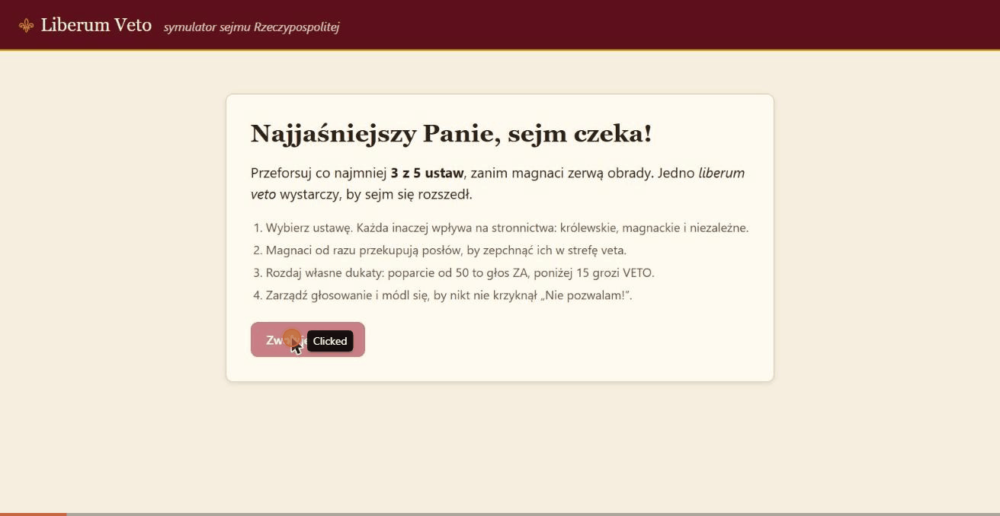

# Sejmik 🏛️

> Turowa gra o sejmach Rzeczypospolitej: jako Król próbujesz przeforsować ustawy, a magnaci przekupują posłów, żeby jednym vetem zerwać obrady. Do zagrania w konsoli albo w przeglądarce (Angular + Spring Boot).

**EN:** A turn-based strategy game about the 17th-century Polish-Lithuanian parliament, where a single veto can break the Sejm. Playable in the console or in the browser. A full-stack portfolio project: core Java 21 domain, Spring Boot 4 REST API with JPA, and an Angular 22 frontend.

[](https://github.com/hubertkubiak/sejmik/actions/workflows/ci.yml)




---

## Zasady gry

- Gra trwa **5 sejmów**. W każdym Król dostaje budżet: **100 dukatów + 20 za każdą przyjętą ustawę**.
- Król **wybiera ustawę** z 3 wylosowanych. Każda inaczej wpływa na frakcje: królewską, magnacką i niezależną.
- **Magnaci** (komputer) od razu rozdają łapówki, żeby zepchnąć posłów w strefę veta.
- Król **przekupuje posłów**, żeby podnieść ich poparcie.
- W **głosowaniu** każdy poseł liczy poparcie:

  ```
  poparcie = lojalność + wpływ ustawy na frakcję + (łapówki króla − łapówki magnatów) × przekupność
  ```

  | Poparcie | Głos |
  |---|---|
  | ≥ 50 | **ZA** |
  | 15–49 | **PRZECIW** |
  | < 15 | **VETO** z prawdopodobieństwem `(15 − poparcie) / 15` |

- **Jedno veto zrywa sejm.** Bez veta ustawa przechodzi zwykłą większością.
- **Wygrana Króla:** co najmniej 3 przyjęte ustawy. **Wygrana magnatów:** co najmniej 3 zerwane sejmy. Inaczej remis: *Rzeczpospolita trwa*.

## Uruchomienie

Wymagania: **JDK 21** i **Node.js 24** (tylko dla frontendu). Mavena nie trzeba instalować, bo projekt ma Maven Wrapper.

```bash
# build + wszystkie testy + raporty pokrycia (domain, console, api)
./mvnw clean verify                      # Windows: .\mvnw.cmd clean verify
```

### Gra w przeglądarce

```bash
# terminal 1: REST API na http://localhost:8080 (gry zapisują się w ./data, baza H2)
java -jar api/target/sejmik-api-0.5.0-SNAPSHOT.jar

# terminal 2: frontend na http://localhost:4200
cd frontend
npm ci
npm start
```

| Adres | Co tam jest |
|---|---|
| http://localhost:4200 | gra |
| http://localhost:8080/swagger-ui.html | dokumentacja API (Swagger UI) |
| http://localhost:8080/h2-console | podgląd bazy (JDBC URL `jdbc:h2:file:./data/sejmik`, user `sa`, bez hasła) |

### Gra w konsoli

```bash
java -jar console/target/sejmik.jar
```

Komendy: `przekup <id> <kwota>`, `posłowie` (`p`), `statystyki` (`s`), `głosuj` (`g`), `zapisz`, `pomoc` (`?`), `wyjdź`. Polskie znaki są opcjonalne. Stan gry zapisuje się do `save.json`, a przy następnym uruchomieniu gra proponuje wczytanie.

```
=== SEJM 1/5 | Budżet króla: 100 dukatów ===
Wybierz ustawę:
 1) Zniesienie ceł na spław zboża              [królewska +0, magnacka +15, niezależna +10]
 2) Pobór łanowy na wojnę z Moskwą             [królewska +20, magnacka -20, niezależna +0]
 3) Potwierdzenie przywilejów szlacheckich     [królewska -10, magnacka +20, niezależna +15]
> 3
Magnaci rozdają łapówki... (przekupionych posłów: 3)
> statystyki
Zagrożeni vetem (3):
  [5] Bogusław Leszczyński h. Trąby: poparcie 0
  [16] Ignacy Wiśniowiecki h. Doliwa: poparcie 0
  [15] Andrzej Morsztyn h. Nałęcz: poparcie 2
```

## REST API

Pełny opis w Swagger UI. Jedna tura to wybór ustawy, dowolnie wiele łapówek i głosowanie:

| Metoda | Endpoint | Co robi |
|---|---|---|
| `POST` | `/api/games` | nowa gra (201 + `Location`) |
| `GET` | `/api/games/{id}` | stan gry |
| `GET` | `/api/games/{id}/bills` | 3 ustawy do wyboru w tej turze |
| `PUT` | `/api/games/{id}/selected-bill` | `{"billId": 7}`: wybór ustawy; magnaci od razu przekupują |
| `GET` | `/api/games/{id}/deputies?faction=royal&sort=support` | posłowie z poparciem i szansą na veto |
| `POST` | `/api/games/{id}/bribes` | `{"deputyId": 1, "amount": 30}` |
| `POST` | `/api/games/{id}/votes` | głosowanie, wynik sejmu i stan gry |
| `GET` | `/api/games/{id}/history` | wyniki poprzednich sejmów |

Błędy przychodzą jako `application/problem+json` (RFC 9457): `400` złe dane, `404` brak gry, `409` akcja niepasująca do stanu gry, `422` brak dukatów. Pole `detail` jest po polsku i nadaje się do pokazania graczowi.

```bash
GAME=$(curl -si -X POST localhost:8080/api/games | grep -i location | cut -d' ' -f2 | tr -d '\r')
curl -s $GAME/bills
curl -s -X PUT  -H 'Content-Type: application/json' -d '{"billId": 7}' $GAME/selected-bill
curl -s -X POST -H 'Content-Type: application/json' -d '{"deputyId": 1, "amount": 30}' $GAME/bribes
curl -s -X POST $GAME/votes
```

Na Windowsie w PowerShellu używaj `curl.exe` (samo `curl` to tam alias `Invoke-WebRequest`).

## Technologie

| Obszar | Technologia |
|---|---|
| Język backendu | **Java 21 (LTS)** |
| Build | **Maven 3.9** (projekt wielomodułowy, Maven Wrapper), maven-shade-plugin, spring-boot-maven-plugin |
| Backend | **Spring Boot 4.2**: Spring MVC 7, Bean Validation, ProblemDetail, embedded Tomcat |
| Persystencja | **Spring Data JPA** (Hibernate 7), **H2** w pliku, optimistic locking (`@Version`) |
| Dokumentacja API | **springdoc-openapi 3** (OpenAPI 3, Swagger UI) |
| Serializacja | **Jackson** (zapis gry konsolowej i JSON w API) |
| Frontend | **Angular 22**: standalone components, sygnały, `@Service`, Signal Forms, leniwe trasy, `HttpClient` |
| Język frontendu | **TypeScript 6**, SCSS |
| Testy backendu | **JUnit 6**, **AssertJ**, `MockMvcTester`, `@SpringBootTest` (128 testów) |
| Testy frontendu | **Vitest**, `TestBed`, `HttpTestingController` (22 testy) |
| Pokrycie | **JaCoCo**, reguła ≥ 80% linii dla modułu `domain` (build pada poniżej progu) |
| CI | **GitHub Actions**: build i testy backendu oraz frontendu przy każdym pushu |

## Koncepty w projekcie

### Java (moduły `domain` i `console`)

| Koncept | Gdzie |
|---|---|
| Klasy, hermetyzacja, `equals`/`hashCode` encji | [`Deputy`](domain/src/main/java/pl/hubert/sejmik/domain/model/Deputy.java) |
| Interfejs i polimorfizm | [`Voter`](domain/src/main/java/pl/hubert/sejmik/domain/model/Voter.java) |
| Klasa abstrakcyjna, dziedziczenie, wzorzec *template method* | [`Player`](domain/src/main/java/pl/hubert/sejmik/domain/player/Player.java), [`King`](domain/src/main/java/pl/hubert/sejmik/domain/player/King.java), [`Magnate`](domain/src/main/java/pl/hubert/sejmik/domain/player/Magnate.java) |
| Enumy z polami i metodami | [`Faction`](domain/src/main/java/pl/hubert/sejmik/domain/model/Faction.java), [`GameResult`](domain/src/main/java/pl/hubert/sejmik/domain/game/GameResult.java) |
| Rekordy, kompaktowy konstruktor, kopie obronne (`Map.copyOf`, `List.copyOf`) | [`Bill`](domain/src/main/java/pl/hubert/sejmik/domain/model/Bill.java), [`VoteResult`](domain/src/main/java/pl/hubert/sejmik/domain/sejm/VoteResult.java) |
| `sealed interface` + record patterns + wyczerpujący `switch` | [`Command`](console/src/main/java/pl/hubert/sejmik/console/Command.java), [`ConsoleUI`](console/src/main/java/pl/hubert/sejmik/console/ConsoleUI.java) |
| `switch` jako wyrażenie, text blocks | [`DeputyGenerator`](domain/src/main/java/pl/hubert/sejmik/domain/game/DeputyGenerator.java), [`ConsoleUI`](console/src/main/java/pl/hubert/sejmik/console/ConsoleUI.java) |
| Wyjątki checked i unchecked, własne wyjątki z danymi, multi-catch, opakowywanie (`cause`) | [`exception/`](domain/src/main/java/pl/hubert/sejmik/domain/exception/), [`Game.vote`](domain/src/main/java/pl/hubert/sejmik/domain/game/Game.java), [`CommandParser`](console/src/main/java/pl/hubert/sejmik/console/CommandParser.java) |
| Kolekcje: `EnumMap`, `LinkedHashMap`, niemutowalne listy | [`Sejm`](domain/src/main/java/pl/hubert/sejmik/domain/sejm/Sejm.java), [`Statistics`](domain/src/main/java/pl/hubert/sejmik/domain/game/Statistics.java) |
| Stream API: `groupingBy`, `counting`, `averagingInt`, `toMap`, komparatory, `IntStream`, `Optional` | [`Statistics`](domain/src/main/java/pl/hubert/sejmik/domain/game/Statistics.java), [`Sejm`](domain/src/main/java/pl/hubert/sejmik/domain/sejm/Sejm.java) |
| Lambdy, referencje do metod, `Supplier` / `Function` jako zależności, metody generyczne | [`Main`](console/src/main/java/pl/hubert/sejmik/console/Main.java), [`ConsoleUI.run`](console/src/main/java/pl/hubert/sejmik/console/ConsoleUI.java), [`GameService`](api/src/main/java/pl/hubert/sejmik/api/service/GameService.java) |
| Wstrzykiwanie zależności przez konstruktor, composition root | [`Main`](console/src/main/java/pl/hubert/sejmik/console/Main.java) |
| Pliki: NIO.2 (`Path`, `Files`), zapis atomowy, try-with-resources, zasoby z classpath | [`SaveFile`](console/src/main/java/pl/hubert/sejmik/console/save/SaveFile.java), [`TextResources`](console/src/main/java/pl/hubert/sejmik/console/TextResources.java) |
| DTO + mapper (domena niezależna od Jacksona) | [`save/`](console/src/main/java/pl/hubert/sejmik/console/save/) |
| Testy: parametryzowane, test double (`Random` z ustaloną wartością), round-trip z `usingRecursiveComparison` | [`domain/src/test`](domain/src/test/java/pl/hubert/sejmik/), [`console/src/test`](console/src/test/java/pl/hubert/sejmik/) |

### Spring Boot (moduł `api`)

| Koncept | Gdzie |
|---|---|
| Warstwy controller → service → repository, DTO oddzielone od encji | [`GameController`](api/src/main/java/pl/hubert/sejmik/api/controller/GameController.java), [`GameService`](api/src/main/java/pl/hubert/sejmik/api/service/GameService.java), [`dto/`](api/src/main/java/pl/hubert/sejmik/api/dto/) |
| IoC i DI: `@Service`, `@Repository`, `@Configuration` + `@Bean` dla klas bez Springa | [`GameConfig`](api/src/main/java/pl/hubert/sejmik/api/config/GameConfig.java) |
| Walidacja `@Valid`, `@NotNull`, `@Positive` | [`BribeRequest`](api/src/main/java/pl/hubert/sejmik/api/dto/BribeRequest.java) |
| Globalna obsługa błędów, ProblemDetail (RFC 9457) | [`ApiExceptionHandler`](api/src/main/java/pl/hubert/sejmik/api/error/ApiExceptionHandler.java) |
| JPA: encje, `@OneToMany`, `@ElementCollection`, `@Version`, Spring Data `JpaRepository` | [`repository/`](api/src/main/java/pl/hubert/sejmik/api/repository/) |
| Transakcje `@Transactional` (`readOnly`), `open-in-view` wyłączone | [`GameService`](api/src/main/java/pl/hubert/sejmik/api/service/GameService.java), [`application.properties`](api/src/main/resources/application.properties) |
| CORS, konwersja parametrów (`WebMvcConfigurer`), OpenAPI | [`WebConfig`](api/src/main/java/pl/hubert/sejmik/api/config/WebConfig.java), [`OpenApiConfig`](api/src/main/java/pl/hubert/sejmik/api/config/OpenApiConfig.java) |
| Testy `@SpringBootTest` + `MockMvcTester`, baza w pamięci dla testów | [`api/src/test`](api/src/test/java/pl/hubert/sejmik/api/) |

### Angular (katalog `frontend`)

| Koncept | Gdzie |
|---|---|
| Typowane DTO i serwis HTTP (`@Service`, `inject`, `HttpClient`) | [`core/api/`](frontend/src/app/core/api/) |
| Stan na sygnałach: `signal`, `computed`, `asReadonly`, niemutowalne aktualizacje | [`GameStore`](frontend/src/app/game/game-store.ts) |
| Komponenty: `input()`, `output()`, `model()` i `[(...)]` | [`DeputyTile`](frontend/src/app/game/deputy-tile/deputy-tile.ts), [`SejmHall`](frontend/src/app/game/sejm-hall/sejm-hall.ts) |
| Signal Forms z własną walidacją | [`BribePanel`](frontend/src/app/game/bribe-panel/bribe-panel.ts) |
| Leniwe trasy, parametr trasy jako `input` | [`app.routes.ts`](frontend/src/app/app.routes.ts), [`app.config.ts`](frontend/src/app/app.config.ts) |
| Animacje CSS, `prefers-reduced-motion`, dostępność (ARIA, `role="status"`) | [`VoteResult`](frontend/src/app/game/vote-result/) |

## Architektura

```
sejmik/
├── domain/     sejmik-domain    reguły gry w czystej Javie, bez żadnych zależności runtime
├── console/    sejmik-console   gra w terminalu, zapis do save.json (Jackson)
├── api/        sejmik-api       Spring Boot: REST, JPA + H2, Swagger
├── frontend/   Angular 22             gra w przeglądarce, rozmawia z api przez HTTP
└── .github/    CI na GitHub Actions
```

```
przeglądarka ──HTTP/JSON──▶ GameController ──▶ GameService ──▶ GameRepository ──▶ H2
                                                   │                (JPA)
konsola ──▶ ConsoleUI ─────────────────────────────┤
                                                   ▼
                                    domain: Game, Sejm, Deputy… (bez Springa, bez I/O)
```

Logika gry jest w jednym miejscu (`domain`), a konsola i REST API to tylko dwa sposoby jej wywołania. Moduł `domain` nie ma żadnych zależności, więc kompilator sam pilnuje, żeby reguły gry nie sięgnęły po Springa, bazę czy pliki.

Kod (nazwy, komentarze, testy, JSON) jest po angielsku. Po polsku jest tylko to, co widzi gracz.

### Słowniczek

| Polski | W kodzie |
|---|---|
| poseł | `Deputy` |
| ustawa | `Bill` |
| frakcja (królewska / magnacka / niezależna) | `Faction` (`ROYAL` / `MAGNATE` / `INDEPENDENT`) |
| głos (ZA / PRZECIW / VETO) | `Vote` (`FOR` / `AGAINST` / `VETO`) |
| poparcie, lojalność, przekupność | support, `loyaltyToKing`, `corruptibility` |
| łapówka, przekupić | bribe |
| zerwanie sejmu | `SejmDissolvedException`, `VoteResult.dissolved()` |
| herb | `coatOfArms` |

## Roadmapa

- [x] M1: model domeny (`v0.1-model`)
- [x] M2: algorytm głosowania i `Sejm` (`v0.2-glosowanie`)
- [x] M3: konsolowa pętla gry, przekupstwa, AI magnatów (`v0.3-konsola`)
- [x] M4: statystyki na Streamach, zapis i odczyt JSON (`v0.4-statystyki-zapis`)
- [x] M5: multi-module Maven, Spring Boot REST API, JPA + H2, walidacja, Swagger, CORS (`v0.5-api`)
- [x] M6: front w Angularze, CI na GitHub Actions (`v0.6-frontend`)

Pomysły na dalszy rozwój są w [SPEC.md](SPEC.md) (punkt 12): kilku magnatów ze strategiami, zdarzenia losowe, konfederacja, ranking graczy, symulacja tysięcy gier na `ExecutorService`.

Pełna specyfikacja: [SPEC.md](SPEC.md). Historia zmian: [CHANGELOG.md](CHANGELOG.md).
